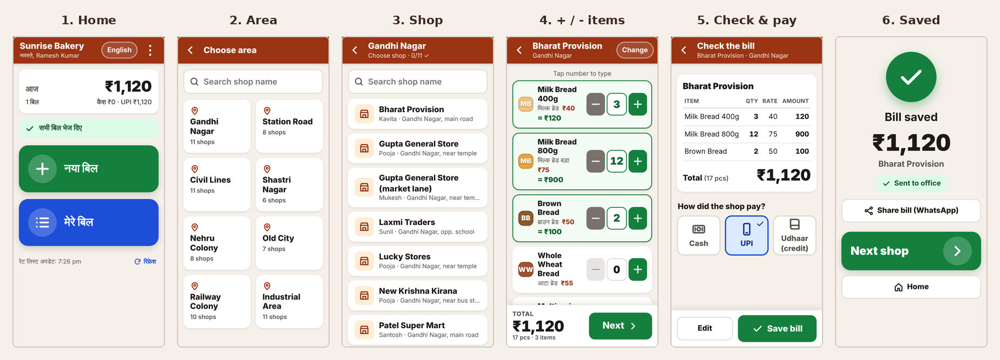
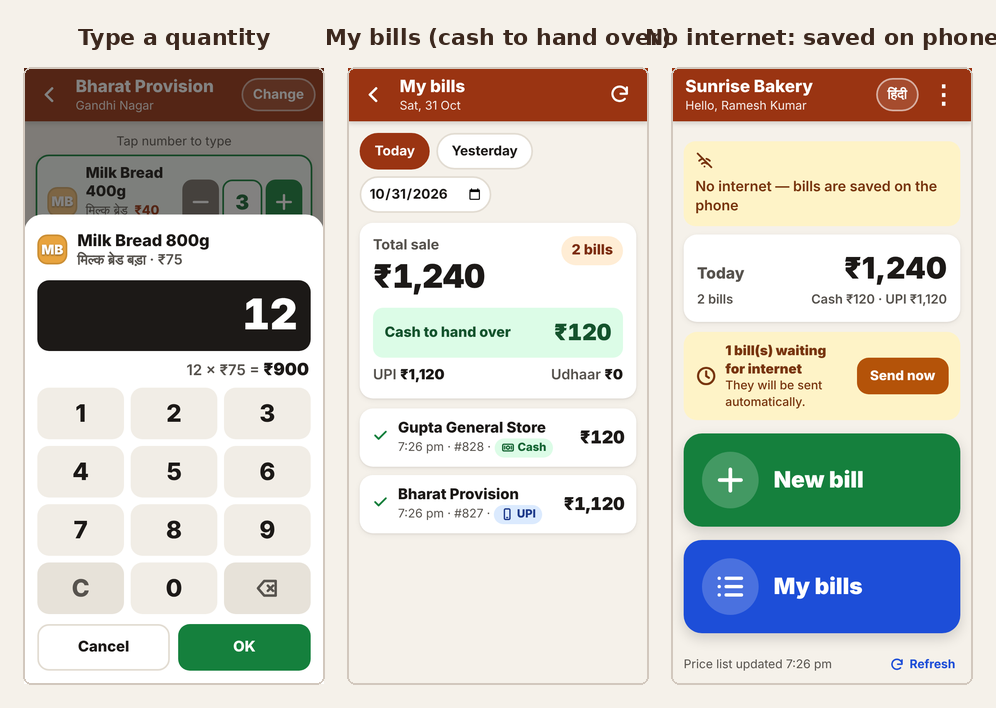
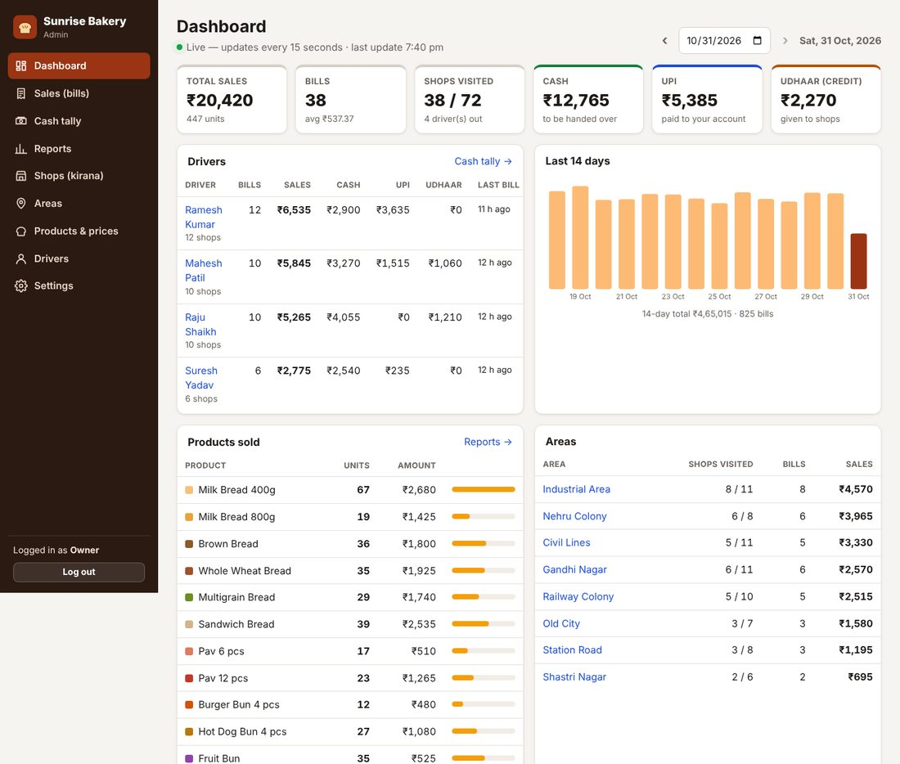
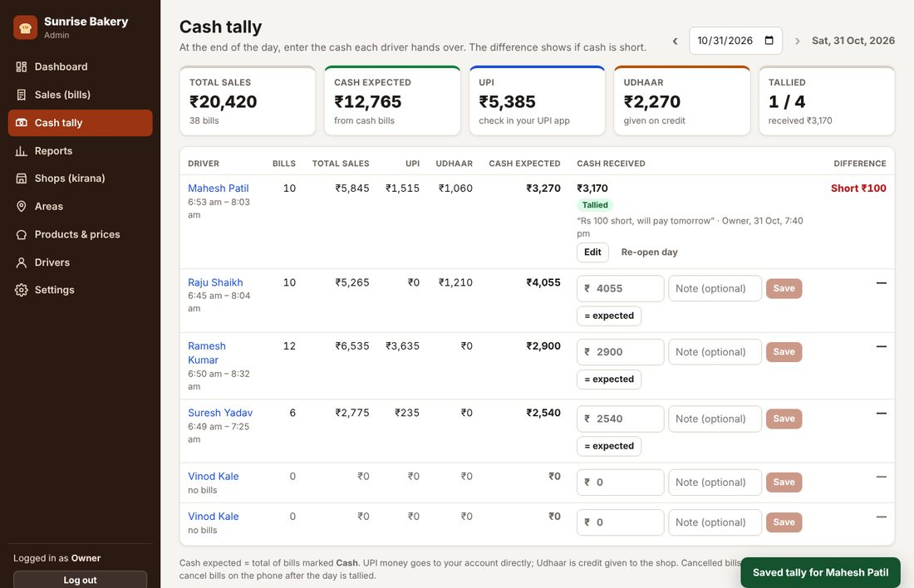

# Bread Sales — billing app for drivers + sales website for the owner

A simple system for a bakery that sells bread to kirana shops from delivery autos.

* **Drivers** use an Android app with very big buttons (Hindi or English): choose the **area**, choose the
  **shop**, press **+ / −** for each product, and the app shows the **exact total**. They choose
  Cash / UPI / Udhaar and press **Save bill**. No more adding up in their heads.
  The Android app is a thin wrapper around the driver **web app**, so every change to the website reaches
  all phones at once — no new APK needed.
* **You (the owner)** see every bill on a website **as soon as it is saved**. The website has a cash tally
  for each driver, reports, shops, products and prices, and drivers.









---

## What it does

### Driver app (Android)

| Screen | What the driver does |
| --- | --- |
| Login | Mobile number + 4–6 digit PIN (once — the app stays logged in) |
| Home | Today's total, **New bill**, **My bills**. Shows if any bills are waiting for internet |
| Area → Shop | Big area buttons, then the shops of that area (with search). Shops already billed today get a ✓ and the amount. The search box on the area screen searches all shops |
| Items | All products with colour, name, local name and price. **+ / −** buttons, or tap the number to type it on a calculator pad (e.g. 24). The total updates live at the bottom. Shops with special rates get their discount automatically (the normal price is struck out, e.g. “5% off”) |
| Expired return | A second tab on the same screen: count the **expired items taken back and replaced with fresh ones**, with the same + / − buttons (amber, “No charge”). It does not change the money. A visit where only expired bread is replaced (nothing sold) is saved the same way |
| Check bill | Bill table (item, qty, rate, amount) with each discount, the total in large digits, the expired items replaced, and how the shop paid: **Cash / UPI / Udhaar** |
| Saved | Big ✓ and the amount. **Share bill** on WhatsApp, **Next shop** |
| My bills | Bills for today, yesterday or any date. Shows **Cash to hand over**, UPI, udhaar and the expired items taken back. Each bill can be opened and shared, and cancelled within 30 minutes if it was a mistake |
| Add shop | If a new kirana shop wants bread, the driver can add it on the spot (marked “added by driver” on your website) |

**Works without internet.** Bills are saved on the phone first and sent automatically when the internet comes
back. The same bill is never counted twice. The shop list and prices are kept on the phone and refreshed
automatically when there is internet.

**Totals are always correct.** Prices come only from your website (drivers cannot change them).
All money is calculated in whole paise, and the server checks every bill total again before saving it.

### Owner website

| Page | Use it for |
| --- | --- |
| **Dashboard** | Today's sales, live (refreshes every minute): total, bills, shops visited, cash / UPI / udhaar, per driver, per area, products sold, last 14 days, latest bills |
| **Sales (bills)** | Every bill with filters (dates, driver, area, payment, cancelled, shop name or bill number). Open a bill to see the items; cancel a wrong bill (with a reason) or restore it. Download as CSV (opens in Excel) |
| **Cash tally** | At the end of the day: for each driver, **cash expected** (cash bills only), UPI, udhaar and how many expired items they should bring back. Type the cash handed over and the page shows **Short ₹… / Extra ₹… / Matches**. If a late bill arrives after you tallied, the page warns you. After you tally a day, the driver can no longer cancel bills from that day on the phone |
| **Reports** | Any date range, grouped by product, shop, area, driver or day, with the discount given and the expired items taken back, and CSV download |
| **Shops (kirana)** | Search, filter by area, find shops with no bill for 3/7/30 days, add/edit/remove shops, see each shop's purchases (what they buy, average bill, udhaar, recent bills). **Import your whole shop list from Excel** |
| **Areas** | Add/rename areas, set their order in the app |
| **Products & prices** | Add products, change prices (with price history), colours, order in the app, hide products |
| **Discounts** | Special rates for some shops: for each product **% off** or **₹ off each**. The driver app takes them off by itself and the bill (and WhatsApp bill) shows the discount. Set them from the Discounts page or a shop's page |
| **Drivers** | Add drivers (mobile + PIN), change PIN, turn off, log out a lost phone, unlock after wrong PINs, see today's sales and when the app was last used |
| **Settings** | Business name / phone / bill footer (shown on WhatsApp bills), change password, add more admin users (manager, accountant) |

The website also works on a phone.

---

## How the pieces fit

```
 Driver phones: Android app = wrapper            You (browser)
 that opens the driver web app in Chrome              │
        │  HTTPS, works offline + sync                │
        ▼                                             ▼
 ┌──────────────────────── Cloudflare (free) ────────────────────────┐
 │  Driver web app (/driver/)        Admin website (/)               │
 │  API (/api/driver/*, /api/admin/*) — a Cloudflare Worker          │
 └─────────────────────────────────┬─────────────────────────────────┘
                                   ▼
                     D1 database (SQLite, run by Cloudflare)
```

| Folder | What is in it |
| --- | --- |
| `server/` | API (Node.js / Express). Runs on Cloudflare Workers with a D1 database, or on any computer with Node.js 22 and a SQLite file. Database tables in `server/migrations/`, tests in `server/test/`, Cloudflare settings in `server/wrangler.jsonc` and `server/cloudflare/` |
| `admin-web/` | Owner website (React) |
| `driver-app/` | Driver web app (React, works offline), served at `/driver/` |
| `android-wrapper/` | The Android app: a small wrapper (Trusted Web Activity) that opens the driver web app full screen in Chrome |
| `Dockerfile`, `docker-compose.yml`, `Caddyfile` | Optional: run everything on your own server instead of Cloudflare |
| `../.github/workflows/bread-sales.yml` | GitHub Actions: tests, **puts the website online on Cloudflare** and **builds the Android app**. GitHub only reads workflows from the top-level `.github` folder |
| `../.github/workflows/bread-sales-live-check.yml` | “Run workflow” with your website address to check that the live site answers correctly |

---

## 1. Put it online (free: Cloudflare + GitHub)

Everything runs on free plans, with no credit card and no server to look after:

* **Cloudflare** runs the website, the API for the app and the database. It does not sleep, so pages and
  bills are fast at any time of day.
* **GitHub** tests every change, puts it online on Cloudflare, and builds the Android app (Releases).

**Step 1 — Cloudflare account (2 minutes).** Sign up at **https://dash.cloudflare.com/sign-up** (free plan,
no card needed) and confirm your email.

**Step 2 — a key that lets GitHub update your site (3 minutes).**
1. In Cloudflare: click the person icon (top right) → **My Profile** → **API Tokens** → **Create Token**.
2. Next to **Edit Cloudflare Workers** click **Use template**.
3. Under *Permissions* click **+ Add more** and choose **Account** → **D1** → **Edit**.
4. *Account Resources*: your account. *Zone Resources*: **All zones**. → **Continue to summary** →
   **Create Token** → **Copy** the token (it is shown only once). Keep it private.

**Step 3 — four secrets in GitHub (3 minutes).** In the repository on GitHub: **Settings → Secrets and
variables → Actions → New repository secret**, and add:

| Name | Value |
| --- | --- |
| `CLOUDFLARE_API_TOKEN` | the token from step 2 |
| `ADMIN_PASSWORD` | the password you will use for the owner website (at least 8 characters) |
| `ANDROID_KEYSTORE_BASE64` | the long text from the signing key file (see section 3) |
| `ANDROID_KEYSTORE_PASSWORD` | the password of the signing key |

**Step 4 — run it.** **Actions → Bread Sales → Run workflow → Run workflow.** After 5–10 minutes the run
shows a green tick and a summary with your links:

* Owner website: `https://bread-sales.<your-name>.workers.dev` — log in with username **`owner`** and your
  `ADMIN_PASSWORD` (change it later under Settings).
* Android app for drivers: `https://github.com/<you>/<repo>/releases/latest/download/bread-sales.apk`

The first run also creates the database. A brand-new `workers.dev` address can take a few minutes before it
opens. If the run fails, open it and read the red error line: it says what is missing.

**Updates:** every change pushed to the main branch is tested and put online automatically. Use **Run
workflow** to also publish a new Android app (rarely needed: the app shows the website, so it updates itself).

**What “free” means here.** Cloudflare's free plan has daily limits (requests to the API, and rows the
database reads and writes per day) that are far above what a bakery with ~20 drivers and ~500 shops uses.
The owner website refreshes once a minute and pauses when nobody is using it, to stay well inside them.
If a limit were ever reached, the drivers' phones keep their bills and send them after the daily reset
(05:30 India time) — nothing is lost.

### Backups

* **Download:** owner website → **Settings → Download backup now**. Keep the file
  (`bread-sales-backup-….json.gz`) in Google Drive or similar, **at least once a week** (the dashboard
  reminds you). It contains all your business data — keep it private.
* **Undo a recent mistake:** Cloudflare also keeps the database's history for recent days (“Time Travel”).
  On a computer with Node.js 22, in `bread-sales-tracker/server` (after `npm install`, with
  `CLOUDFLARE_API_TOKEN` set): `npx wrangler d1 time-travel info bread-sales` shows it, and
  `npx wrangler d1 time-travel restore bread-sales --timestamp=2026-01-31T08:00:00+05:30` goes back to that time.
* **Restore a downloaded backup into Cloudflare** (replaces everything in the online database):
  ```bash
  cd bread-sales-tracker/server
  npm install
  npm run restore -- ~/Downloads/bread-sales-backup-2026-01-31_0800.json.gz --replace --sql restore.sql
  CLOUDFLARE_API_TOKEN=… npx wrangler d1 execute bread-sales --remote --file restore.sql
  ```
* On your own server (option B): `npm run restore -- <file> --replace` with `DATABASE_PATH` pointing to the
  database file (in Docker: `docker compose exec app node dist/scripts/restore-backup.js /tmp/b.json.gz --replace`
  after `docker compose cp <file> app:/tmp/b.json.gz`).

### B. Your own server (VPS) with Docker — only if you ever want to leave Cloudflare

Cost: a small VPS (~₹500 per month) and a domain name (~₹800 per year).

1. **Domain:** in your domain's DNS settings add an **A record**, e.g. `sales.mybakery.in` → your server's IP address.
2. **Install Docker** on the server (Ubuntu): `curl -fsSL https://get.docker.com | sh`
3. **Get the code and settings:**
   ```bash
   git clone https://github.com/<you>/breadnew.git
   cd breadnew/bread-sales-tracker
   cp .env.example .env
   nano .env        # fill in DOMAIN, JWT_SECRET (openssl rand -hex 32), ADMIN_PASSWORD, BUSINESS_NAME
   docker compose up -d --build
   ```
   Caddy gets a free HTTPS certificate for your domain by itself. The data is one SQLite file in the
   `app-data` Docker volume; download backups from the website as above.
4. To move your data: download a backup on the old site and restore it on the new one (see *Backups*).

Updating: `git pull && docker compose up -d --build` (table changes are applied automatically).
Then build the Android app for the new address (`APP_URL`, see section 3).

---

## 2. Set up your business in the website (first day)

1. **Products & prices** → add your ~17 products with the price you charge shops. Give each a colour and
   (optional) its Hindi/local name, then use ▲▼ to put them in the order the driver should see.
2. **Shops** → **Import from Excel / CSV**. Make a sheet with these columns (first row = headings):

   | Area | Shop name | Owner | Phone | Address |
   | --- | --- | --- | --- | --- |
   | Gandhi Nagar | Sharma Kirana | Ramesh Sharma | 9876543210 | Near Hanuman temple |
   | Station Road | Gupta General Store | | | Opp. bus stand |

   Copy the cells (with the heading row) and paste them in, or upload the CSV. Click **Check**, then
   **Import**. Areas are created automatically, and importing the same list again skips shops that already
   exist. Two shops with the same name in one area must be told apart, e.g. “Sharma Kirana (near temple)”.
3. **Drivers** → **Add driver** with name + mobile number. A PIN is suggested; give the mobile number and PIN
   to the driver.
4. **Discounts** (only if some shops get special rates) → **Add discount for a shop**, pick the shop, and set
   % off or ₹ off each per product (“Same % off on every product” fills all rows at once). The page shows the
   price that shop will pay. Drivers' phones pick the rates up the next time they have internet.
5. **Settings** → business name, phone and the message printed at the bottom of shared bills.

> Want to try everything first with sample data (8 areas, 72 shops, 17 products, 4 drivers, 2 weeks of
> bills)? Run it on your own computer (see section 7: `npm run seed:demo`), not on the live site.
> Demo drivers log in with 9000000001–9000000004, PIN 1234.

---

## 3. The Android app for drivers

The Android app is a **wrapper**: it opens the driver web app (`https://<your website>/driver/`) full screen
in Chrome, with its own icon and splash screen — no browser address bar. All screens and logic are in the
web app, so changes reach every phone as soon as the website is updated; the APK almost never changes.
It keeps working without internet (Chrome keeps the app on the phone) and bills are saved on the phone
until they can be sent. GitHub builds the APK for you (no Android Studio needed).

### One-time setup: the signing key

Android apps are signed with a key. The same key must sign every version, otherwise phones refuse the
update, and Chrome checks it before showing the app full screen. A key was created for this project and sent
to you as a file (`bread-sales-release.jks`) with a text file holding its password and its
`ANDROID_KEYSTORE_BASE64` text. Put those two values in the GitHub secrets (section 1, step 3) and keep both
files safe and private: **if the key is lost, drivers must uninstall and reinstall the app**.

To make a new key instead, on any computer with Java: `cd android-wrapper && sh scripts/create-keystore.sh`
(it prints the two secret values). The website learns the key's fingerprint automatically on the next run.

Without the signing secrets GitHub builds only a **TEST** APK (`…-TEST.apk`, under the run's *Artifacts*):
it works, but shows a small address bar and cannot be updated in place. Use it only for trying out.

### Getting the APK

* **For drivers:** after **Run workflow** (section 1), the signed app is published under **Releases**.
  Drivers always download the newest version from one fixed link:
  **https://github.com/jaikaran12/breadnew/releases/latest/download/bread-sales.apk**
  (also shown on the website's Drivers page).
* Every other run also builds an APK: **Actions → Bread Sales → the run → Artifacts**.

### Installing on a driver's phone (Android 7 or newer, with Chrome)

1. Open the download link above on the phone (or send the `.apk` on WhatsApp) and tap the downloaded file.
   Chrome may warn that the file can be harmful — choose **Download anyway**.
2. Android asks to allow **“Install unknown apps”** for WhatsApp/Chrome — allow it, then **Install**.
   If Play Protect shows a warning about an unknown app, choose **More details → Install anyway**.
3. Open **Bread Sales**, choose हिंदी or English, enter the driver's mobile number and PIN.
4. The app downloads the shop list and prices. From then on it works even without internet.

**Updates:** website changes reach the app automatically (the next time it is opened). A new APK is only
needed if the wrapper itself changes; install it over the old one.

**Without the APK:** drivers can open `https://<your website>/driver/` in Chrome → menu → **Add to Home
screen**. It is the same app.

### Driver quick guide (हिंदी में — ड्राइवर को समझाने के लिए)

1. **नया बिल** दबाएँ → अपना **एरिया** चुनें → **दुकान** चुनें (ऊपर नाम लिखकर भी खोज सकते हैं)।
2. हर सामान के आगे **+** दबाएँ (कम करने के लिए **−**)। ज़्यादा गिनती हो तो बीच वाला नंबर दबाकर सीधे लिखें।
3. नीचे **कुल** रकम दिखती है — यही दुकानदार से लेनी है। **आगे** दबाएँ।
4. बिल जाँचें, फिर चुनें दुकान ने कैसे पैसे दिए: **कैश / UPI / उधार** → **बिल सेव करें**।
5. **अगली दुकान** दबाएँ। इंटरनेट न हो तो भी बिल फ़ोन में सेव रहता है और नेट आते ही अपने आप चला जाता है।
6. शाम को **मेरे बिल** खोलें — **“जमा करने का कैश”** उतना कैश मालिक को देना है।
7. गलती से बिल बन गया? **मेरे बिल** → बिल खोलें → **यह बिल रद्द करें** (30 मिनट के अंदर), फिर सही बिल बनाएँ।
8. **एक्सपायरी माल:** दुकान में एक्सपायरी ब्रेड मिले तो उसे वापस लें और नई दें। बिल बनाते समय ऊपर
   **एक्सपायरी वापसी** दबाएँ और वापस ली गई गिनती डालें — इसके पैसे नहीं लगते। अगर कुछ बेचा नहीं, सिर्फ़ बदला,
   तब भी ऐसे ही गिनती डालकर **बिल सेव करें**। शाम को एक्सपायरी माल मालिक को दें।
9. कुछ दुकानों को **खास रेट (छूट)** मिलता है — ऐप उसे अपने आप लगाता है। आपको कुछ नहीं करना, बस कुल रकम लें।

---

## 4. Everyday use for the owner

* **During the day:** the **Dashboard** shows bills arriving live. Click a driver or area to see their bills.
* **Evening:** open **Cash tally**, enter the cash each driver hands over and press **Save**. Check UPI
  amounts against your UPI app. Udhaar shows which shops took bread on credit (filter **Sales** by
  “Udhaar only” to follow up).
* **Wrong bill?** Find it under **Sales**, open it, **Cancel this bill…** with a reason. Cancelled bills stay
  visible (struck out) but are not counted anywhere.
* **Price change?** Edit the product. Phones pick up the new price within a few minutes when online. Bills
  made earlier keep their old price. A bill made with an old price list is marked “Old rate”. A % discount
  follows the new price; a “₹ off each” discount stays the same amount.
* **Expired bread:** the **Dashboard** lists what was taken back today, **Cash tally** shows how many expired
  pieces each driver should bring back, and each shop's page shows what it returned in the last 30 days (to
  spot shops that are sent too much).
* **Watch for:** many “Cancelled by driver” bills, shops not visited for days (Shops → “No bill for 7+
  days”), and differences in the cash tally.

---

## 5. Settings reference

On Cloudflare the settings are in `server/wrangler.jsonc` (`vars`; change, push, done) and the secrets are
set by the workflow. On your own server they go in `.env`.

| Variable | Default | Meaning |
| --- | --- | --- |
| `ADMIN_USERNAME` / `ADMIN_PASSWORD` | owner / — | first admin account, created only when there is none (change the password later in Settings) |
| `BUSINESS_NAME` | My Bakery | first business name (change later in Settings) |
| `APP_TIMEZONE` | Asia/Kolkata | decides which day a bill belongs to |
| `DRIVER_CANCEL_WINDOW_MINUTES` | 30 | how long a driver can cancel their own bill (0 = never) |
| `APP_DOWNLOAD_URL` | (set by the workflow) | link to the APK, shown in Settings |
| `ANDROID_APP_ID` | com.breadsales.driver | package name of the Android wrapper app |
| `ANDROID_CERT_SHA256` | (set by the workflow) | SHA-256 fingerprint(s) of the app's signing key, for `/.well-known/assetlinks.json` |
| `JWT_SECRET` | (created once by the workflow) | long random text used to sign logins |
| `DATABASE_PATH` | server/data/bread.sqlite | own server only: the SQLite database file |
| `DOMAIN` | — | own server only (docker compose): your web address for HTTPS |
| `COOKIE_SECURE` | true | set `false` only when testing without HTTPS |
| `TRUST_PROXY` | 1 | own server only: number of proxies in front of the server (Caddy) |
| `LOGIN_RATE_LIMIT` | 30 | login attempts allowed per network per 15 minutes |

---

## 6. Security

* Website login uses a secure, HTTP-only cookie; passwords and PINs are stored only as salted PBKDF2 hashes.
* Five wrong PINs lock that driver for 15 minutes, and logins per network are rate limited.
* Turning a driver off, or changing their PIN, logs their phone out immediately. If a phone is lost, use
  **Drivers → Log out phone**.
* The Android app only opens your own `https://` website; Chrome verifies that the app and the website belong
  together (Digital Asset Links) before showing it full screen.
* Keep the Cloudflare token, `.env`, the signing key (`.jks`) and backups private. Never commit them to Git;
  the token and key live only in GitHub secrets.

---

## 7. For developers

Requirements: Node.js 22.13+ (nothing else: data is kept in a SQLite file).

```bash
# Server (http://localhost:8080), data in server/data/bread.sqlite
cd server
cp .env.example .env
npm install
npm run seed:demo                 # optional demo data
npm run dev

# Admin website with hot reload (http://localhost:5173, calls the server on :8080)
cd admin-web && npm install && npm run dev

# Driver app in the browser (http://localhost:5174)
cd driver-app && npm install && npm run dev
```

The same server on Cloudflare's own runtime (exactly like production, with a local D1 database):

```bash
(cd admin-web && npm run build) && (cd driver-app && npm run build)
cd server && cp .dev.vars.example .dev.vars && npm run build:site && npm run cf:dev   # http://localhost:8787
```

Tests:

```bash
cd server && npm test             # API tests on an in-memory SQLite database; also checks Cloudflare D1 limits
cd admin-web && npm test          # CSV downloads
cd driver-app && npm test         # bill total / merge logic
```

Database changes: add a new file `server/migrations/0002_….sql` (SQLite). It is applied on the next deploy
(`wrangler d1 migrations apply`) and when the Node server starts.

Android wrapper locally (needs Android Studio or the Android SDK + JDK 21):

```bash
cd android-wrapper
APP_URL=https://bread-sales.<your-name>.workers.dev/driver/ ./gradlew assembleDebug
```

Changing the app id (`com.breadsales.driver`, needed before publishing on the Play Store): edit
`android-wrapper/app/build.gradle` (`namespace`, `applicationId`) and `ANDROID_APP_ID` on the server.
Icons are generated by `node android-wrapper/scripts/make-icons.cjs`.

### API overview

All amounts are integers in **paise** (₹42.50 = `4250`). Dates are `YYYY-MM-DD` in `APP_TIMEZONE`.

| Method & path | Who | Purpose |
| --- | --- | --- |
| `POST /api/driver/login` | driver | `{phone, pin}` → `{token, driver}` |
| `GET /api/driver/catalog` | driver | areas, shops, products with prices, business info |
| `POST /api/driver/sales` | driver | save a bill `{clientId, storeId, soldAt, paymentMode, items[{productId, quantity, unitPricePaise}], totalPaise}`. Sending the same `clientId` again returns the saved bill |
| `GET /api/driver/sales?date=` | driver | own bills for a day |
| `POST /api/driver/sales/:id/cancel` | driver | cancel own bill (time limit, not after the day is tallied) |
| `POST /api/driver/stores` | driver | add a shop |
| `POST /api/admin/login` | admin | sets the login cookie |
| `GET /api/admin/dashboard?date=` · `/dashboard/trend?date=` | admin | dashboard numbers, 14-day chart |
| `GET /api/admin/backup/info` · `/backup/table/:name?after=&upto=` · `POST /backup/done` | admin | backup, downloaded in pieces |
| `GET /api/admin/sales` · `/sales/export?date=` (one day, in pages, for CSV files) · `/sales/:id` · `POST /sales/:id/cancel` · `/restore` | admin | bills |
| `GET/PUT/DELETE /api/admin/tally` | admin | cash tally per driver per day |
| `GET /api/admin/reports?groupBy=product\|store\|area\|driver\|day` | admin | reports (the website makes the CSV) |
| `/api/admin/areas`, `/stores` (+ `/import`), `/products` (+ `/reorder`, `/:id/price-history`), `/drivers` (+ `/:id/pin`, `/unlock`, `/logout`), `/settings`, `/admins`, `/password` | admin | manage data |
| `GET /api/health` | anyone | health check |
